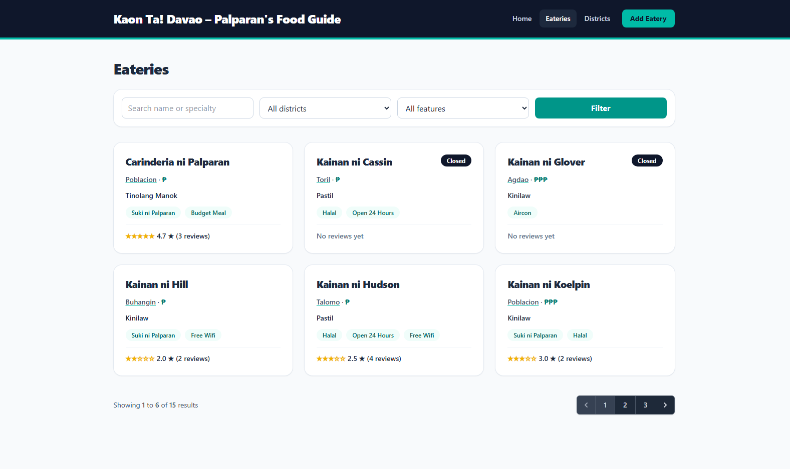
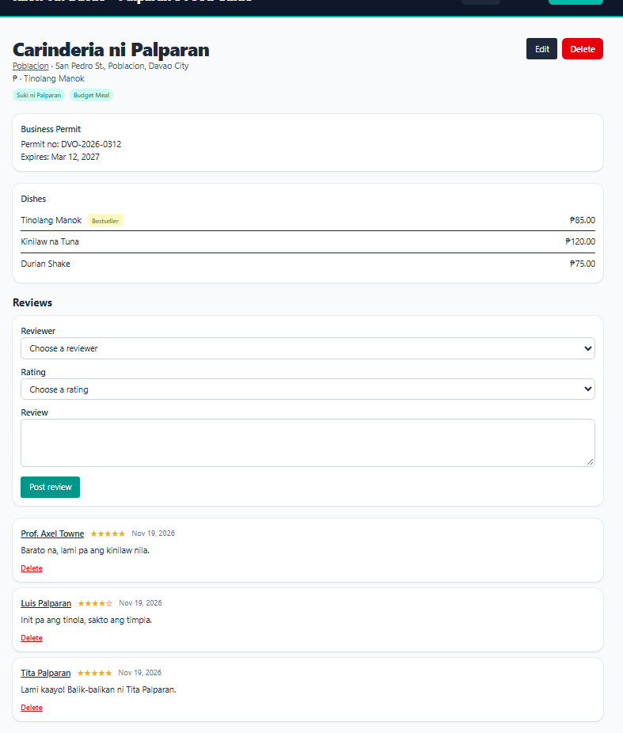
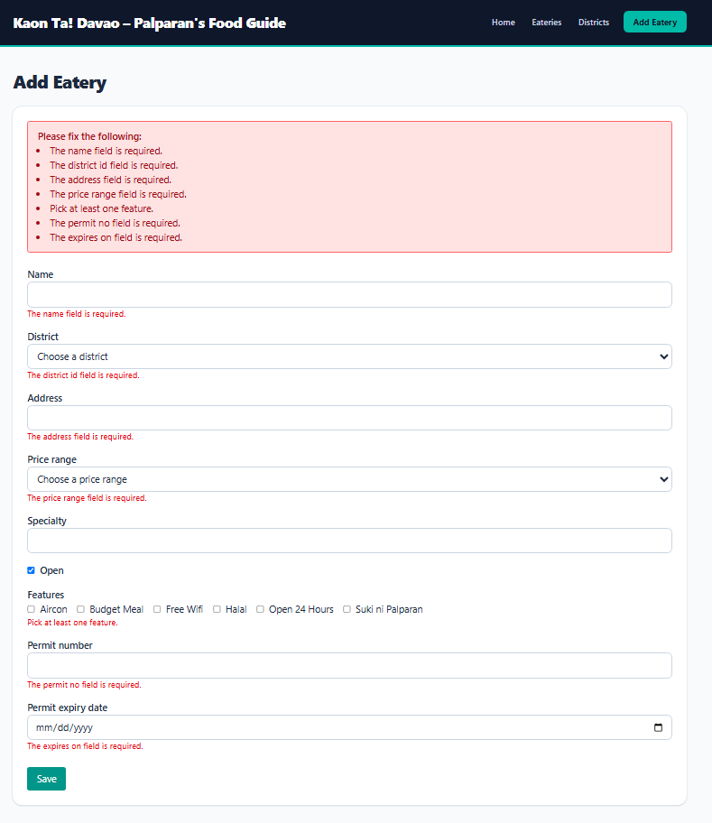

# Kaon Ta! Davao – Palparan's Food Guide

**Author:** Luis Alejandro M. Palparan
**Course:** CS Elective 2 – Full-Stack Development (Laravel), Ateneo de Davao University

A Laravel 12 + SQLite guide to carinderias and eateries in Davao City, built for the Prefinal milestone project.

## Setup

```bash
composer install
cp .env.example .env
php artisan key:generate
touch database/database.sqlite
php artisan migrate:fresh --seed
npm install
npm run build
php artisan serve
```

## My personalized data

- **Districts (6):** Poblacion, Talomo, Agdao, Buhangin, Toril, Tugbok
- **Features (6):** Suki ni Palparan, Budget Meal, Halal, Open 24 Hours, Aircon, Free Wifi
- **My two users:** Luis Palparan (`palparan@kaonta.test`) and Tita Palparan (`tita.palparan@kaonta.test`), password `kaonta2026`
- **My eatery:** Carinderia ni Palparan (slug `carinderia-ni-palparan`), Poblacion, San Pedro St., Poblacion, Davao City
- **Permit:** DVO-2026-0312, expiring March 12, 2027

## Relationships

## Relationships

| Relationship | Type | Why this type fits |
|---|---|---|
| District → Eatery | hasMany / belongsTo | One district can have many eateries, but each eatery belongs to only one district. |
| Eatery → Dish | hasMany / belongsTo | One eatery lists many dishes, and each dish belongs to one eatery only. |
| Eatery → Review | hasMany / belongsTo | One eatery gets many reviews, and each review is about one eatery only. |
| User → Review | hasMany / belongsTo | One user can write many reviews, and each review has one writer. |
| Eatery → Permit | hasOne / belongsTo | Each eatery has exactly one permit, which is why eatery_id is unique. |
| Eatery ↔ Feature | belongsToMany (pivot eatery_feature) | An eatery has many features and a feature applies to many eateries, so a junction (associative) table is needed. |
| District → Review | hasManyThrough (via Eatery) | Reviews don't store district_id, so the district reaches them through the eatery table. |
## Routes

```

 GET|HEAD / .. home › HomeController
 GET|HEAD districts .. districts.index › DistrictController@index
 GET|HEAD districts/{district} .. districts.show › DistrictController@show
 GET|HEAD eateries .. eateries.index › EateryController@index
 POST eateries .. eateries.store › EateryController@store
 GET|HEAD eateries/create .. eateries.create › EateryController@create
 GET|HEAD eateries/{eatery} .. eateries.show › EateryController@show
 PUT|PATCH eateries/{eatery} .. eateries.update › EateryController@update
 DELETE eateries/{eatery} .. eateries.destroy › EateryController@destroy
 GET|HEAD eateries/{eatery}/edit .. eateries.edit › EateryController@edit
 POST eateries/{eatery}/reviews .. eateries.reviews.store › ReviewController@store
 GET|HEAD reviewers/{user} .. reviewers.show › ReviewerController@show
 DELETE reviews/{review} .. reviews.destroy › ReviewController@destroy

 Showing [13] routes


```

## Screenshots



